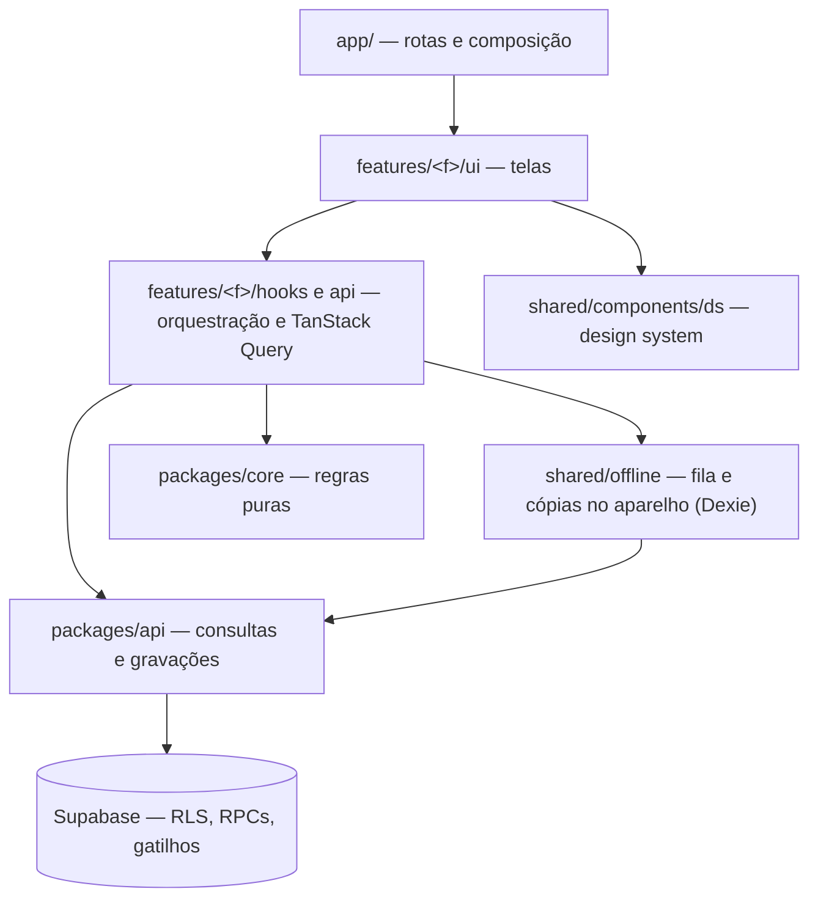

# Arquitetura de código — Guf App

# 0. Informações

Este documento tem como finalidade explicar como o código do guf é organizado, em camadas e pastas, e por quê.

| Feito por | Glauber |
| --- | --- |
| Data de Criação | 18/10/2026 |

Regras detalhadas e caminhos de cada funcionalidade: [`CLAUDE.md`](../CLAUDE.md). Padrões de engenharia: `.claude/skills/code-standards`.

## 1. Bases que não mudam

- **Site estático:** Next.js com `output: "export"`. Não há servidor nosso: nada de Server Actions, Route Handlers, middleware ou SSR com dados.
- **Backend e banco = Supabase:** Postgres com RLS (é o RLS que protege os dados), RPCs para operações atômicas, gatilhos, pg_cron e Edge Functions para o que exige a chave secreta.
- **PWA e offline:** Serwist gera o service worker no build; o treino em andamento grava numa fila no aparelho (Dexie) e envia quando há internet.

## 2. Camadas



| Camada | Onde | Responsabilidade |
|---|---|---|
| Rota | `apps/web/src/app/` | Declara a rota e mostra a tela da feature |
| Apresentação | `features/<f>/ui`, `features/<f>/components` | Telas e partes da tela |
| Orquestração | `features/<f>/hooks`, `features/<f>/api` | Estado da tela, cache e invalidação (TanStack Query) |
| Domínio | `packages/core` | Regras de negócio puras (1RM, volume, recordes, datas, textos) |
| Validação | `packages/schemas` | Schemas Zod |
| Acesso a dados | `packages/api` (+ `shared/offline`) | Supabase com contrato `{ data, error }`; fila e cópias locais |
| Banco | `supabase/` | Tabelas, RLS, RPCs, gatilhos, migrations, Edge Functions |

## 3. Pastas do app web

```
apps/web/src/
├── app/                 # rotas; providers.tsx compõe os providers globais
├── features/<feature>/  # api/ hooks/ helpers/ constants/ components/ providers/ ui/ type.ts index.ts
├── shared/              # components/ds, components/ui, components/workout-summary, hooks, helpers, libs, offline, preferences, push, sound
├── store/global/        # toast.store.ts, pwa.store.ts
├── mocks/               # espelho de packages/api para desenvolvimento
└── styles/tokens/
```

Features atuais: `app-shell`, `auth`, `design-system` (só dev), `evolution` (evolução por exercício e resumo do treino), `exercise-picker`, `history`, `home`, `legal`, `not-found`, `onboarding` (tour de onboarding), `plans` (planos e portão do Pro), `profile`, `projects`, `pwa`, `routine`, `share`, `workout`.

**Regras de dependência**
- `app/` e outras features importam uma feature só pelo barrel (`@/features/<f>`); dentro da feature, pelo caminho.
- `shared/` nunca importa `features/`. A composição entre features fica em `app/` (ex.: `app/providers.tsx`).
- `packages/*` nunca importa `apps/*` nem React.
- Usado por uma feature só → fica nela. Segundo uso em outra feature → sobe para `shared/` (ou para `packages/` se for regra ou consulta que o app mobile também vai usar).
- Permissões por plano: as telas perguntam "pode usar X?" ao `usePlanGate()` (`features/plans`), nunca o nome do plano; o catálogo e os limites de gravação ficam no banco. Detalhes em `docs/plans-and-access.md`.
- Exemplo de inversão de dependência: alertas do menu inferior. As features publicam em `store/global/nav-alerts.store.ts` e o AppShell só lê; as fontes são montadas em `app/(app)/layout.tsx` (o AppShell não importa as features que o importam).
- Exemplo: o resumo do treino é usado pelo seu treino (`evolution`) e pelo de outra pessoa (`social`), então as partes ficam em `shared/components/workout-summary/` sem conhecer rotas nem a origem dos dados (recebem `WorkoutSummaryBase` e callbacks/slots); cada tela decide o que é tocável e quais ações aparecem. A montagem dos dados também é única (`packages/api/src/summary-builder.ts`, interno do pacote).
- Exemplo de inversão de dependência na tela do treino: `useWorkoutEditing` (lista de exercícios, séries, observações, troca e reordenação) recebe um `WorkoutChangeSink` que diz para onde vai cada alteração. O treino em andamento passa a fila offline (`outboxSink`); a edição de um treino concluído passa um destino vazio e grava tudo de uma vez no fim (`save_workout_edit`). O `WorkoutEditor` desenha a lista e as folhas sem saber qual dos dois está em uso; cada tela só compõe cabeçalho, rodapé e as próprias ações.

## 4. SOLID na prática

| Princípio | Como aparece no guf |
|---|---|
| Responsabilidade única | Cálculo em `packages/core`, consulta em `packages/api`, tela em `ui/`; um hook por finalidade |
| Aberto/fechado | Catálogo de modelos de Stories (`share/constants/story-catalog.ts`): modelo novo entra na lista sem mexer na folha |
| Substituição de Liskov | Mocks em `src/mocks/` têm a mesma assinatura das funções reais (`satisfies XxxApi`); a tela não percebe a troca |
| Segregação de interfaces | Contratos por domínio (`ProjectsApi`, `ProfileApi`, `EvolutionApi`…) em vez de um cliente único |
| Inversão de dependência | A tela depende do contrato via `useXxxSource()`, que entrega a API real ou o mock; o cliente Supabase entra por parâmetro (`(client, input)`) |

## 5. Por que pastas por feature funcionam com Supabase

A organização por feature trata do **front**. Com Supabase, o papel de "backend" (controller/service/repository) é dividido entre o banco (RLS, RPCs, gatilhos) e os pacotes do monorepo. Por isso:

- Não existe `shared/http/` nem `fetch` próprio: `packages/api` faz esse papel, com o cliente oficial do Supabase.
- Cada feature tem uma pasta `api/` fina, só com os hooks do TanStack Query que chamam `packages/api`. A regra de negócio fica em `packages/core`, e a segurança fica no banco.
- O que é infraestrutura do aparelho (fila offline, cache, preferências, sons) fica em `shared/`, porque várias features usam.
- Os pacotes (`core`, `schemas`, `api`, `types`) são o que o app Expo vai reaproveitar. As features do web são só a camada de tela.
