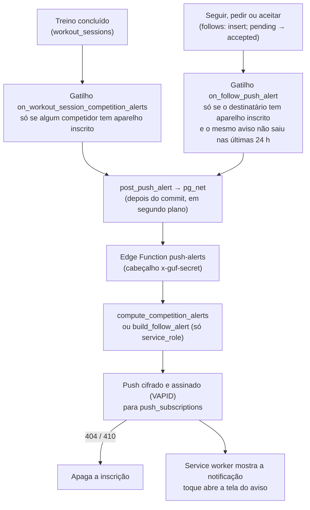

# Notificações no celular (Web Push): competição e seguidores

# 0. Informações

Este documento descreve os avisos no celular (o que avisa, como funciona, custo, situação e configuração).

| Feito por | Glauber |
| --- | --- |
| Data de Criação | 19/10/2026 |

## O que avisa

Quem liga **Configurações › Preferências › Notificações** recebe avisos neste aparelho:

| Aviso | Quando | Para quem | Ao tocar |
|---|---|---|---|
| "Fulano está chegando" (ou "empatou com você") | Um competidor fica a menos de 20 pontos de passar você na temporada atual ("Este mês") | Quem está sendo alcançado | `/competicao` |
| "Fulano te ultrapassou" | Um competidor passa você na temporada atual | Quem foi ultrapassado | `/competicao` |
| "Novo seguidor" | Alguém começa a seguir seu perfil aberto | Quem foi seguido | Perfil de quem seguiu |
| "Pedido para seguir" | Alguém pede para seguir seu perfil privado | Quem recebeu o pedido | `/solicitacoes` |
| "Pedido aceito" | Quem você pediu para seguir aceitou (inclusive ao abrir o perfil, que aceita os pedidos pendentes) | Quem pediu | Perfil de quem aceitou |

- **Competição:** um aviso por mudança de posição e por competidor (`competition_alert_states`). Quem tem 0 pontos na temporada não recebe.
- **Seguidores:** no máximo 1 aviso a cada 24 h por pessoa, destinatário e tipo (`follow_alerts_sent`, guardado por 1 dia). O próprio gatilho confere e reserva o aviso antes de chamar a função: seguir, deixar de seguir e seguir de novo em menos de 24 h gera 1 aviso e 1 requisição só. Só sai se o vínculo ainda está como no evento e não há bloqueio. Recusar, remover e bloquear não avisam ninguém.

## Como funciona



- **Banco:** `supabase/migrations/20261019225621_push_alerts.sql` (`push_subscriptions`, `competition_alert_states`, `follow_alerts_sent`, `save_push_subscription`, `compute_competition_alerts`, `build_follow_alert`, `post_push_alert`, gatilhos `on_workout_session_competition_alerts` e `on_follow_push_alert`, `export_my_data` no formato `guf-export/4`) e `20261019232551_push_alerts_follow_cooldown.sql` (intervalo de 24 h dos avisos de seguidores conferido no gatilho).
- **Edge Function:** `supabase/functions/push-alerts/index.ts` (textos dos avisos em português).
- **App:** `packages/api/src/push.ts` (`PushApi`), `apps/web/src/shared/push/web-push.ts` (inscrição do aparelho), `features/profile/hooks/use-push-alerts.ts` + `components/push-alerts-row.tsx`, eventos `push` e `notificationclick` em `apps/web/sw/sw.ts`. Sair da conta apaga a inscrição no servidor e a cancela no navegador (`AuthProvider`).
- **Limite do iPhone:** só com o app instalado na Tela de Início (iOS 16.4+). No `next dev` não há service worker: a opção aparece como indisponível (use `/configuracoes?estado=padrao` para simular).

## Custo

Uma chamada da Edge Function por evento que tem destinatário com notificações ligadas (treino concluído, seguir, pedir, aceitar). Ex.: 1.000 usuários × (15 treinos + ~10 eventos de seguidores) por mês ≈ 25 mil chamadas, contra 500 mil no Free e 2 milhões no Pro. pg_net e a entrega do push (Google/Apple/Mozilla) não custam nada.

## Situação (2026-10-19)

| Etapa | Situação |
|---|---|
| Migrations `push_alerts`, `legal_privacy_push_alerts` e `push_alerts_follow_cooldown` | Aplicadas no projeto vinculado em 2026-10-19 |
| Tipos do banco (`packages/types/src/database.ts`) | Regenerados com `supabase gen types` em 2026-10-19 |
| Política de Privacidade 0.4-dev | Publicada no banco em 2026-10-19: quem já tem conta passa pelo `/aceite`; até o app novo estar no ar, o `/aceite` mostra o texto anterior |
| Chaves VAPID | Geradas em 2026-10-19 (`vapid.json` na raiz, fora do git) |
| Secrets da função (`VAPID_KEYS`, `VAPID_SUBJECT` = `mailto:` do contato de privacidade, `PUSH_ALERTS_SECRET`) | Gravados em 2026-10-19 |
| Edge Function `push-alerts` | Publicada em 2026-10-19 (`--no-verify-jwt`) |
| Segredos do Vault (`project_url`, `push_alerts_secret`) | Criados em 2026-10-19 pela CLI (`supabase db query --linked`) |
| `NEXT_PUBLIC_VAPID_PUBLIC_KEY` no `apps/web/.env.local` | Feito em 2026-10-19 |
| `NEXT_PUBLIC_VAPID_PUBLIC_KEY` na Vercel | **Pendente**: cadastrar no painel (Settings › Environment Variables, Production e Preview) e publicar de novo; sem ela, a opção "Notificações" aparece como indisponível no site |
| Teste com um aviso real (dois celulares, contas que se seguem) | **Pendente** |

**Conferido em 2026-10-19:** sem o segredo, a função responde 401; com o segredo e um usuário inexistente, responde `{"sent":0}`; `post_push_alert` chamado no banco chega à função pelo pg_net (status 200 em `net._http_response`). A leitura das chaves VAPID e o envio só acontecem quando há um aviso de verdade, por isso ainda falta o teste com celulares.

## Chaves e segredos

| Item | Onde fica | Quem usa |
|---|---|---|
| Chave pública VAPID | `NEXT_PUBLIC_VAPID_PUBLIC_KEY` (`.env.local` e Vercel); pode ficar visível | App, ao inscrever o aparelho |
| Par de chaves VAPID (com a privada) | Secret `VAPID_KEYS` da função; cópia em `vapid.json` na raiz (fora do git) | Edge Function, ao assinar o envio |
| `VAPID_SUBJECT` | Secret da função (`mailto:` do `PRIVACY_CONTACT_EMAIL`) | Serviços de push, para contato em caso de problema |
| Segredo entre banco e função | Secret `PUSH_ALERTS_SECRET` e Vault `push_alerts_secret` (o mesmo valor) | Gatilhos (envia) e função (confere) |
| URL do projeto | Vault `project_url` | Gatilhos, para chamar a função |

- **Guardar a chave privada:** copie o `vapid.json` para um gerenciador de senhas e apague o arquivo da pasta. Os secrets do Supabase não mostram o valor depois de gravados.
- **Trocar as chaves VAPID** (se a privada vazar): gerar outro par, gravar `VAPID_KEYS`, trocar `NEXT_PUBLIC_VAPID_PUBLIC_KEY` e publicar o app. As inscrições antigas param de funcionar: apague-as (`delete from push_subscriptions`) e cada pessoa liga as notificações de novo.
- **Trocar o segredo entre banco e função:** gravar o novo valor no secret `PUSH_ALERTS_SECRET` e no Vault (`vault.update_secret`) ao mesmo tempo. Enquanto os dois forem diferentes, a função recusa as chamadas (401) e nenhum aviso sai.
- **Conferir falhas:** `select status_code, content, created from net._http_response order by created desc limit 20;` (respostas da função às chamadas do banco) e os logs da função no painel do Supabase (só contagens, sem conteúdo dos avisos).

## Problemas comuns

| Sintoma | Causa provável | O que fazer |
|---|---|---|
| Permissão aceita, mas o botão volta para desligado e aparece "Não foi possível ativar as notificações neste aparelho" | Service worker ainda não ativo (app recém-instalado ou atualizando) ou serviço de push recusou (sem internet, chave pública inválida) | Fechar e abrir o app e tentar de novo; conferir `NEXT_PUBLIC_VAPID_PUBLIC_KEY` na Vercel (sem aspas nem espaços) e publicar de novo |
| Opção aparece como indisponível | Build sem `NEXT_PUBLIC_VAPID_PUBLIC_KEY`, navegador sem Web Push ou iPhone fora da Tela de Início | Cadastrar a chave e publicar; no iPhone, instalar o app |
| Ligado, mas nenhum aviso chega | Segredos do Vault ou da função diferentes, ou função fora do ar | `select status_code, content from net._http_response order by created desc limit 20;` e logs da função |

Até 2026-10-19 a falha na inscrição era engolida (o botão voltava sem aviso); agora `subscribeDevicePush` espera o service worker ativo (`navigator.serviceWorker.ready`, até 10 s) e devolve o motivo (`DeviceSubscribeResult`), e a tela mostra o erro.

## Configuração (uma vez por ambiente)

1. Chaves VAPID: `node supabase/scripts/generate-vapid-keys.mjs > vapid.json` (o JSON tem a chave privada: está no `.gitignore`). A linha `NEXT_PUBLIC_VAPID_PUBLIC_KEY=…` sai no terminal.
2. App: `NEXT_PUBLIC_VAPID_PUBLIC_KEY` no `apps/web/.env.local` e nas variáveis da Vercel.
3. Secrets da função, por arquivo (o valor não aparece na linha de comando nem no histórico do terminal):
   ```
   # push-secrets.env (fora do repositório; apagar depois)
   VAPID_KEYS='<conteúdo do vapid.json em uma linha>'
   VAPID_SUBJECT=mailto:<contato>
   PUSH_ALERTS_SECRET=<segredo aleatório, ex.: node -e "console.log(require('crypto').randomBytes(32).toString('hex'))">

   npx supabase secrets set --env-file push-secrets.env
   ```
4. Publicar: `npx supabase db push` e `npx supabase functions deploy push-alerts --no-verify-jwt --use-api`.
5. Vault (segredos não vão em migration), pelo SQL Editor ou por `npx supabase db query --linked -f <arquivo.sql>`:
   ```sql
   select vault.create_secret('https://<ref>.supabase.co', 'project_url');
   select vault.create_secret('<mesmo segredo do passo 3>', 'push_alerts_secret');
   ```
   Para trocar um valor que já existe: `vault.update_secret(<id>, '<novo valor>')`. Sem esses dois segredos, os gatilhos não fazem nada.
6. Regenerar os tipos (`packages/types/src/database.ts`) depois de aplicar as migrations.
7. Conferir: chamar a função sem o segredo (401), com o segredo e um usuário inexistente (`{"sent":0}`) e `select public.post_push_alert('{"kind":"competition","user_id":"00000000-0000-0000-0000-000000000000"}')` no banco, olhando a resposta em `net._http_response`.

## LGPD

Atividade A020 em `.lgpd/data-map.md`; RIPD social v0.4 (riscos R010–R013); Política de Privacidade 0.4-dev (`20261019230418_legal_privacy_push_alerts`, publicada no banco em 2026-10-19); serviços de push em `.lgpd/vendors/push-services.md`.
